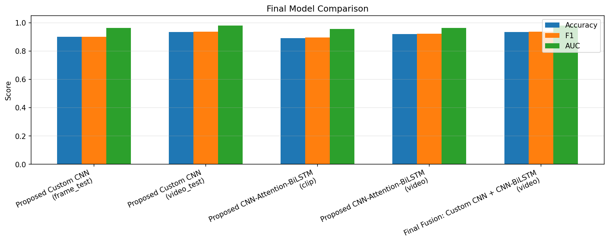
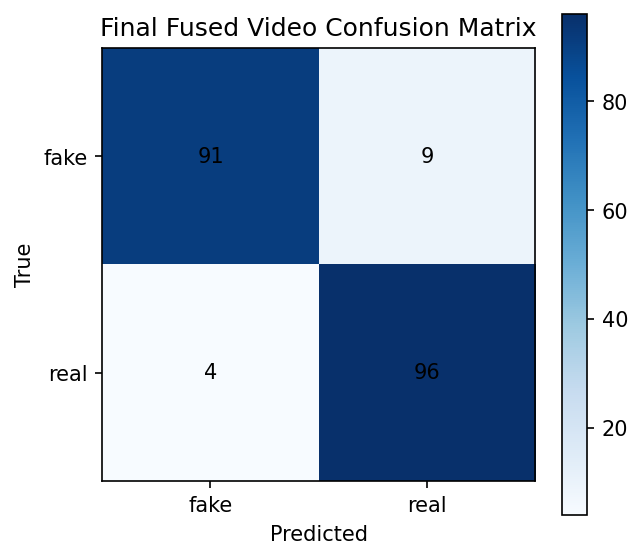
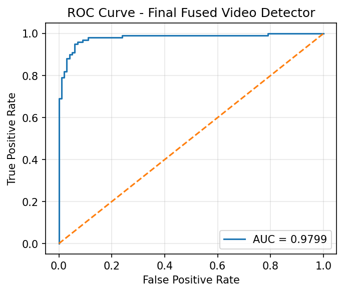
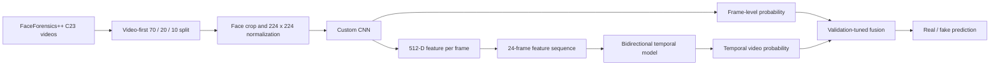
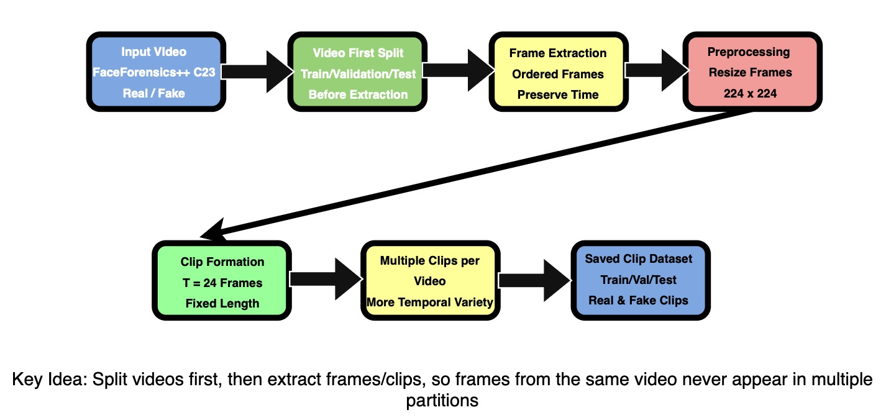
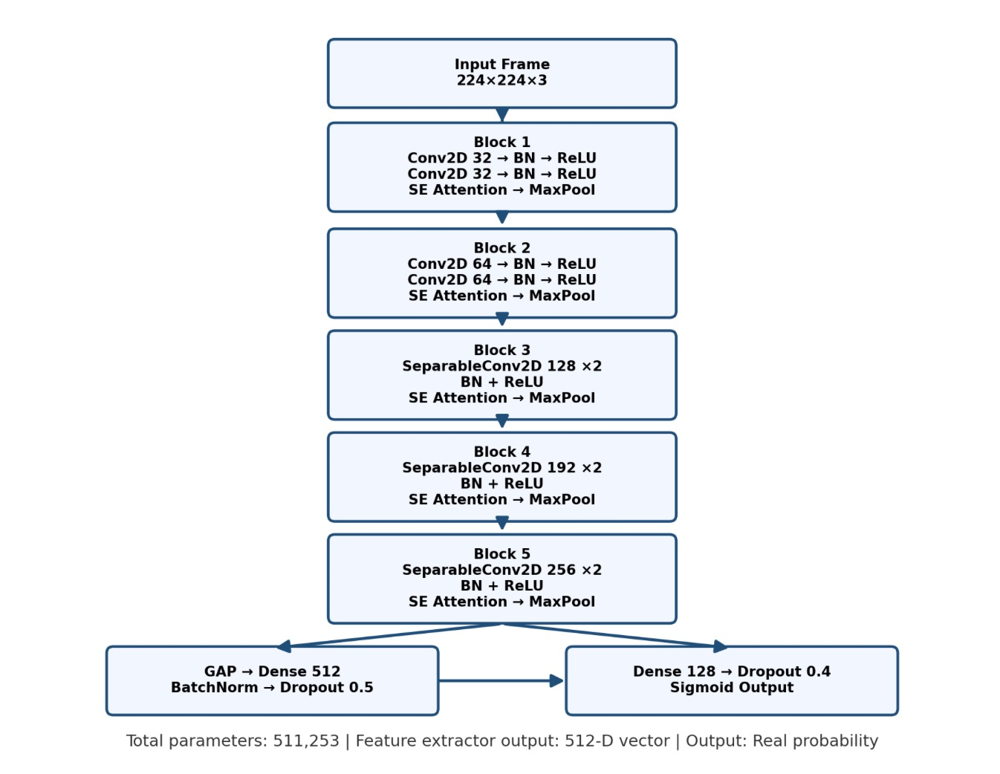
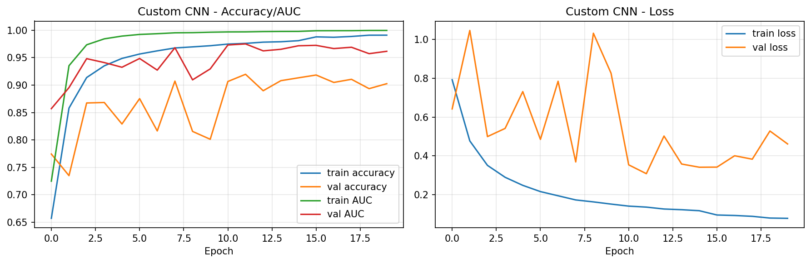
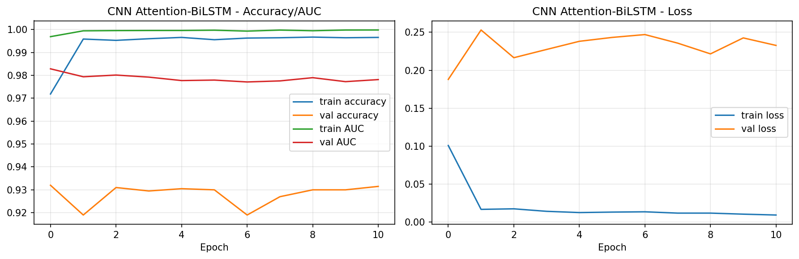

# Seeing Beyond the Fake

### Lightweight spatial-temporal deepfake detection with a custom CNN, video-first evaluation, and decision fusion

[](https://www.python.org/)
[](https://www.tensorflow.org/)
[](https://github.com/ondyari/FaceForensics)
[](LICENSE)
[](papers/seeing-beyond-the-fake-undergraduate-thesis.pdf)
[](papers/seeing-beyond-the-fake-ieee-csde-2026-accepted-paper.pdf)

This repository accompanies the undergraduate thesis **“Seeing Beyond the Fake: Detecting Deepfakes Using Deep Learning-Based Computer Vision.”** The study asks whether a compact, purpose-built model can combine facial artifacts and temporal inconsistencies to detect manipulated videos without relying on a heavyweight pretrained backbone.

**Navigate:** [Research papers](papers/README.md) · [Reproducibility guide](docs/REPRODUCIBILITY.md) · [Model card](docs/MODEL_CARD.md) · [Dataset notes](docs/DATASET.md) · [Results](results/)



## Why this study matters

Many deepfake experiments split extracted frames at random. Frames from one source video can then appear in both training and test sets, making performance look better than it is. This work instead splits **complete videos first**, then extracts frames and clips independently inside each partition.

The proposed system evaluates three related views of the problem:

1. **Spatial evidence:** a 511,253-parameter Custom CNN learns texture, blending, and facial-boundary artifacts from individual frames.
2. **Temporal evidence:** ordered 24-frame clips become sequences of 512-dimensional CNN features for bidirectional temporal modeling.
3. **Decision fusion:** validation-selected weights combine frame-derived and temporal video scores.

## Headline results

All final test results use previously unseen FaceForensics++ C23 videos.

| Detector | Evaluation level | Accuracy | Precision | Recall | F1 | AUC |
| --- | --- | ---: | ---: | ---: | ---: | ---: |
| Custom CNN | Frame | **90.06%** | - | - | - | **96.44%** |
| CNN-BiLSTM temporal branch | Video | **92.00%** | 89.62% | 95.00% | 92.23% | **96.45%** |
| Spatial-temporal fusion | Video | **93.50%** | 91.43% | 96.00% | 93.66% | **97.99%** |

The fusion detector correctly classified 187 of 200 test videos: 91/100 fake videos and 96/100 real videos.

| Final confusion matrix | Final ROC curve |
| --- | --- |
|  |  |

## Method



The split happens before either frame extraction or clip generation:



### Custom spatial backbone

The scratch-built CNN combines standard and depthwise-separable convolution blocks with batch normalization, squeeze-and-excitation channel weighting, L2 regularization, and dropout. Global average pooling produces a compact 512-D representation for temporal modeling.



### Evaluation evidence

| Custom CNN training | Temporal training |
| --- | --- |
|  |  |

Additional confusion matrices and ROC curves are available under [`docs/figures`](docs/figures).

## Publications

The complete research documents are available in the [`papers/`](papers/) directory.

| Document | Status | Access |
| --- | --- | --- |
| Undergraduate thesis | Accepted by Brac University, June 2026 | [Read the full thesis](papers/seeing-beyond-the-fake-undergraduate-thesis.pdf) |
| IEEE conference paper | Accepted at the 11th IEEE Asia-Pacific Conference on Computer Science and Data Engineering (IEEE CSDE 2026); official publication and DOI pending | [Read the accepted paper](papers/seeing-beyond-the-fake-ieee-csde-2026-accepted-paper.pdf) |

See the [publication guide](papers/README.md) for authorship, citation templates, publication status, and document-rights information. Once the IEEE Xplore record becomes available, its DOI and canonical link should be added there.

## Repository structure

```text
.
├── notebooks/
│   └── deepfake_detection_pipeline.ipynb  # Clean, output-free research workflow
├── src/
│   └── deepfake_detection_pipeline.py     # Percent-style Python export
├── configs/
│   └── example.env                        # Portable path configuration
├── results/
│   ├── final_metrics.json
│   └── final_video_confusion_matrices.csv
├── papers/
│   ├── README.md
│   ├── seeing-beyond-the-fake-undergraduate-thesis.pdf
│   └── seeing-beyond-the-fake-ieee-csde-2026-accepted-paper.pdf
├── docs/
│   ├── DATASET.md
│   ├── MODEL_CARD.md
│   ├── REPRODUCIBILITY.md
│   └── figures/
└── scripts/
    └── validate_notebook.py
```

## Getting started

The full dataset and trained model weights are intentionally not distributed here.

```bash
git clone https://github.com/Aurpo-001/Seeing-Beyond-the-Fake-Detecting-Deepfakes-Using-Deep-Learning-Based-Computer-Vision.git
cd Seeing-Beyond-the-Fake-Detecting-Deepfakes-Using-Deep-Learning-Based-Computer-Vision
python3 -m venv .venv
source .venv/bin/activate
pip install -r requirements.txt
cp configs/example.env .env
```

Arrange the licensed FaceForensics++ C23 data as:

```text
FaceForensics++_C23/
├── original/   # real .mp4 files
└── Deepfakes/  # manipulated .mp4 files
```

Then set `FACEFORENSICS_ROOT` and `DEEPFAKE_PROJECT_ROOT` in your environment and open the notebook:

```bash
jupyter lab notebooks/deepfake_detection_pipeline.ipynb
```

Set `REBUILD_DERIVED_DATA=1` only when you intentionally want to regenerate frame and clip folders. See [Reproducibility](docs/REPRODUCIBILITY.md) for the complete protocol.

## Public-notebook preparation

The original experiment file was left untouched. The repository copy:

- removes 93 stored execution outputs and machine-specific metadata;
- replaces local `/mnt/...` paths with environment variables;
- removes temporary inspection cells;
- prevents automatic deletion of derived datasets unless explicitly enabled;
- fixes baseline-control initialization so a clean-kernel run has defined state;
- exports the same workflow as a readable Python file.

These changes improve portability and safety without changing the model, training, evaluation, or fusion algorithms. See [Implementation Notes](docs/IMPLEMENTATION_NOTES.md) for architecture-label details.

## Limitations and responsible use

- The final evaluation is primarily on FaceForensics++ C23; cross-dataset robustness is not established.
- Performance may change under unseen generators, stronger compression, adversarial processing, non-facial synthetic media, or domain shift.
- A detector score is supporting evidence, not proof that a person created or distributed manipulated media.
- Human review, provenance information, and context should remain part of high-impact decisions.
- Dataset-derived face examples are not redistributed in this public repository.

Read the full [Model Card](docs/MODEL_CARD.md) before adapting the system.

## Authors

Tanvir Bashar Aurpo, Syed Aiman Aabdee, Sifat Alam, and Arobi Alamin Twinkle
Department of Computer Science and Engineering, Brac University, 2026

## Citation

Citation metadata is available in [`CITATION.cff`](CITATION.cff). Ready-to-copy thesis and conference-paper citations are provided in the [publication guide](papers/README.md). Until the IEEE version receives its DOI and final bibliographic record, describe it as an accepted paper with publication forthcoming.

## License

Repository code is released under the [MIT License](LICENSE). The thesis, conference paper, FaceForensics++, and external data are not covered by the software license and retain their respective rights and access terms.
